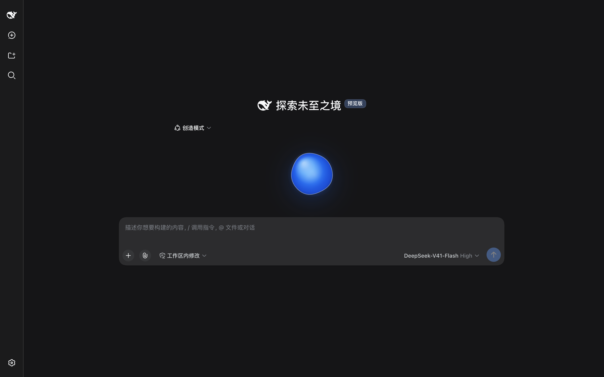
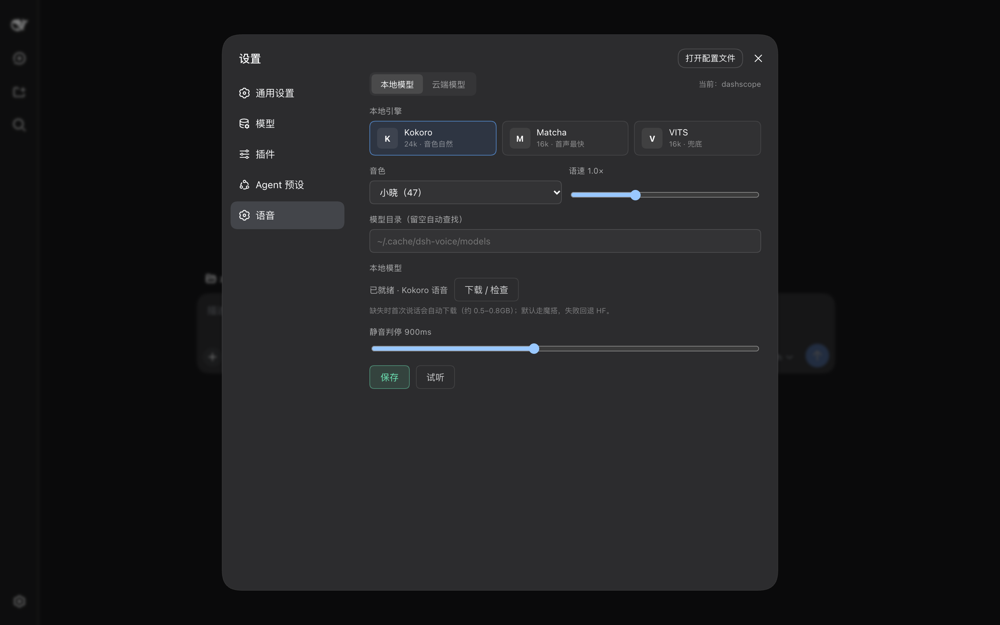

# dsh-voice

[](https://github.com/casperkwok/dsh-voice/actions/workflows/ci.yml)
[](https://github.com/casperkwok/dsh-voice/blob/main/LICENSE)

DeepSeek Harness 的通用全双工语音插件：本地流式识别、本地/云端语音合成、开口即打断、语音审批。

**状态：v0.1.1，可用的垂直切片。** macOS 已实测；Linux / Windows 尚未做设备矩阵验证。DSH `0.1.5-rc.1`、`0.2.1-rc.5` 与 `0.2.2-rc.1` 已跑通。

- 流式 ASR：浏览器麦克风 → 本地 zipformer2，边说边出字
- 本地 TTS：Kokoro fp32 / Matcha / VITS，默认 Kokoro
- 云端 TTS：火山引擎、阿里百炼 Qwen3-TTS、MiniMax
- 真打断：播放期间持续识别，开口停止播放并把最近 3 秒回灌识别
- 语音审批：DSH 弹出授权时，直接说“允许”或“拒绝”
- 模型按需下载：第一次使用语音时才下载，不在安装插件时静默拉取

## 界面





截图来自本地 DSH 真实界面；为保护本机信息，隐藏了工作区名称和本地设置文件路径。

## 环境要求

| 项 | 要求 |
|---|---|
| Node.js | ≥ 22.12 |
| pnpm | 10.x |
| DeepSeek Harness | `>=0.1.5-rc.1 <0.3.0-0`；`0.1.5-rc.1`、`0.2.1-rc.5`、`0.2.2-rc.1` 实测 |
| 磁盘 | 本地模型约 0.5–0.8 GB（按所选 TTS 不同） |
| 麦克风 | 浏览器需允许 `localhost` 使用麦克风 |

`sherpa-onnx-node` 自带平台原生包。macOS 已验证；Linux / Windows 的安装与真实设备行为尚未验收。

## 安装（从源码）

```bash
git clone https://github.com/casperkwok/dsh-voice.git
cd dsh-voice
pnpm install
pnpm build
dsh plugin --profile web add ./packages/voice
```

重启 DSH 的 web profile。插件声明在 `packages/voice/package.json` 的 `dsh` 字段里，`dsh plugin add` 会读取 `cordis.patch.yml` 把插件插入当前 profile。

### 从 GitHub Release 安装

npm 包尚未发布。v0.1.1 的预构建 tarball 可以直接安装：

```bash
dsh plugin --profile web add https://github.com/casperkwok/dsh-voice/releases/download/v0.1.1/dsh-voice-voice-0.1.1.tgz
```

发布后也可以改走 npm：`dsh plugin --profile web add @dsh-voice/voice`。

## 第一次使用

1. 打开任意会话，点输入框右侧的蓝色波形按钮，或按 `⌘⇧V` / `Ctrl+Shift+V`。
2. 如果本地模型缺失，插件会在**第一次开始语音时**自动下载，并在光球下方显示当前文件与百分比。
3. 下载完成后直接说话。停顿约 0.9 秒后自动定稿并发送；助手回复按句合成播放。
4. 播放期间开口说话即打断，不需要等它说完。

模型默认放到：

```
~/.cache/dsh-voice/models
```

查找顺序是：设置里的「模型目录」→ `DSH_VOICE_MODELS` → `~/.cache/dsh-voice/models` → 仓库下的 `.models`（开发态）。

### 手动预下载

不想在第一次说话时等待，可以先跑：

```bash
node scripts/install-models.mjs                 # ASR + VAD + Kokoro fp32
node scripts/install-models.mjs --with-matcha   # 追加 Matcha
node scripts/install-models.mjs --with-vits     # 追加 VITS
```

默认从魔搭（ModelScope）下载，失败自动回退 Hugging Face / GitHub Releases。想强制优先 Hugging Face：

```bash
DSH_VOICE_MODEL_SOURCE=huggingface node scripts/install-models.mjs
```

自动下载读取同一组环境变量。下载完成后按仓库记录的 SHA256 校验；魔搭上的 ASR、Matcha、VITS、VAD 与当前模型逐字节一致，Kokoro 使用 `finchxu/kokoro-multi-lang-v1_1` 并通过本地合成验证。

### 模型目录

```
models/
├── sherpa-onnx-streaming-zipformer-bilingual-zh-en-2023-02-20/
├── silero_vad.onnx
├── kokoro-multi-lang-v1_1/          # 默认本地 TTS
├── matcha-icefall-zh-en/            # 可选
└── sherpa-onnx-vits-zh-ll/          # 可选
```

模型文件不随仓库或 npm 包分发；`.models/` 已在 `.gitignore` 中排除。

## 云端 TTS

打开 **设置 → 插件 → dsh-voice → 语音**，切到「云端模型」。三家 provider 各自保存一份配置：

| Provider | 必填 |
|---|---|
| 火山引擎 | API Key、Resource ID、音色 |
| 阿里百炼 | API Key、Endpoint、模型、音色 |
| MiniMax | API Key、Endpoint、Group ID、模型、音色 |

保存后立即重建 TTS，不需要重启 DSH。设置页的「试听」会用当前 provider 合成一句测试音频。

API Key 只写入本机：

```
~/.dsh-voice/settings.json     # 权限 0600
```

设置接口只返回掩码（最后 4 位）和 `hasApiKey`，不回传明文；提交空 Key 表示保留原 Key。不要把这份 settings 文件复制进仓库、issue 或截图。

## 语音审批

DSH 触发 `approval/request` 时，若当前有活跃语音会话，插件会：

1. 在光球下方显示「需要你授权：<工具名>」；
2. 朗读提示；
3. 等待你说「允许 / 批准 / 可以」或「拒绝 / 不行 / 不要」；
4. 60 秒没有回答则按不可用失败关闭。

授权监听使用 `{ prepend: true }`，优先于 DSH 的 UI 弹窗；没有活跃语音会话时直接交回 DSH 原来的审批流程。

## 隐私与安全

- 没有遥测、没有远程日志。语音数据只在浏览器与本地 DSH 进程之间通过 WebSocket 传输。
- 本地 ASR/TTS 不把音频或文本发给第三方。云端 TTS 只发送要朗读的文本到你选择的 provider。
- API Key 存在 `~/.dsh-voice/settings.json`（0600），不在仓库内，也不会被设置接口明文返回。
- `DSH_VOICE_DEBUG=1` 会在本地终端打印端点判断和文本，调试完请关闭。
- 仓库提交前跑 `pnpm check:secrets`；CI 也会跑。`.env`、`.models/`、`lib/` 已在 `.gitignore` 排除。
- 当前没有 npm 发布、没有 Docker 镜像；模型从魔搭下载，失败回退 Hugging Face / GitHub Releases。
- 下载完成后按 SHA256 校验；已经存在的本地文件不重复计算哈希。

## 设置

| 项 | 说明 |
|---|---|
| 本地引擎 | Kokoro / Matcha / VITS |
| 音色 | Kokoro 45–52；默认 47 |
| 语速 | 0.5–2.0 |
| 线程 | 1–8，默认 4 |
| 静音判停 | 200–2000ms，默认 900ms |
| 模型目录 | 留空自动查找 |
| 云端 provider | 火山 / 阿里百炼 / MiniMax |

句尾是连接词或逗号时会额外等 900ms，短句额外等 500ms，避免把一句话切成两段。

## 开发

```bash
pnpm check          # 密钥扫描 + typecheck + 单测
pnpm test
pnpm build
node spikes/phase0/server.mjs   # Phase 0 延迟/打断实验页，打开 http://127.0.0.1:7799/
```

目录：

```
packages/voice/
├── src/index.ts        # Host 入口（Cordis apply、HTTP/WS 路由、审批桥）
├── src/client.tsx      # Client 入口
├── src/host/           # ASR / VAD / EOU / TTS / 模型下载 / 设置
├── src/client/         # 麦克风按钮、光球、字幕、设置卡
├── src/shared/         # Host–Client 协议与设置类型
├── tests/unit/         # EOU、归一化、分段、设置、三家 TTS 适配器
├── cordis.patch.yml
└── package.json
```

文档：

- [PRD](docs/PRD.md)
- [技术方案](docs/TECH-SPEC.md)
- [ADR](docs/adr/)
- [延迟实测](docs/qa/latency.md)
- [设备矩阵（未完成）](docs/qa/device-matrix.md)
- [插件市场收录说明](docs/marketplace.md)
- [生态与竞争分析](docs/competitive-analysis.md)

## 常见问题

**模型下载失败，HTTP 403 / 超时。** 默认走魔搭；如果魔搭也不通，设 `DSH_VOICE_MODEL_SOURCE=huggingface` 或配置代理。`.part` 文件会保留，重试会从断点继续。

**`sherpa-onnx-node` 加载失败。** 确认 Node 版本 ≥22.12，并在仓库根目录重新 `pnpm install`。原生包按平台分发，目前只验证了 macOS。

**点麦克风没有反应。** 检查浏览器是否允许当前 `localhost` 使用麦克风；DSH 页面不是 HTTPS 时，非 localhost 地址会被浏览器拒绝。

**DSH 版本不兼容。** 当前只在 `0.1.5-rc.1` 上验收；`0.2.x` 的插件 API 尚未复核。安装前看 `packages/voice/package.json` 的 `engines.dsh`。

**云端 TTS 没有声音。** 先在设置页点「试听」；如果试听报错，检查 Key、Endpoint、Resource ID / Group ID 和音色名。试听成功但对话无声，检查是否切回了本地模式。

## 卸载

```bash
dsh plugin --profile web remove @dsh-voice/voice
```

模型和设置不会自动删除：

```bash
rm -rf ~/.cache/dsh-voice
rm -rf ~/.dsh-voice
```

## 已知限制

- AEC 在真实扬声器外放下的误打断率尚未完成设备矩阵；耳机场景已可用。
- 云端 ASR 未接入；ASR 始终在本地。
- 云端 TTS 每句建立一次连接，长回复的句间开销还可以优化。
- 命令词、多人同时说话、移动端布局未做。
- npm 包、代码签名、自动更新未做。

## License

MIT。第三方模型、`sherpa-onnx`、Kokoro、Matcha、VITS 和云服务各自遵循其上游许可证与服务条款；本仓库不重新分发模型权重。
