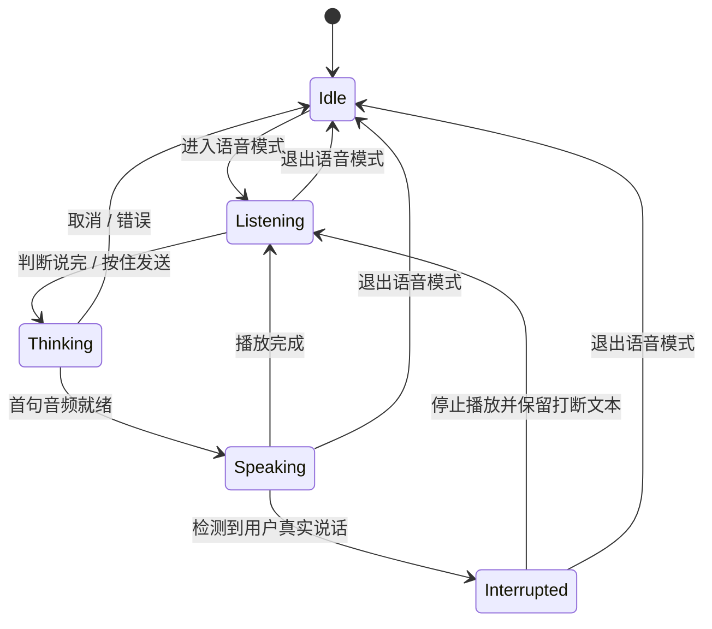
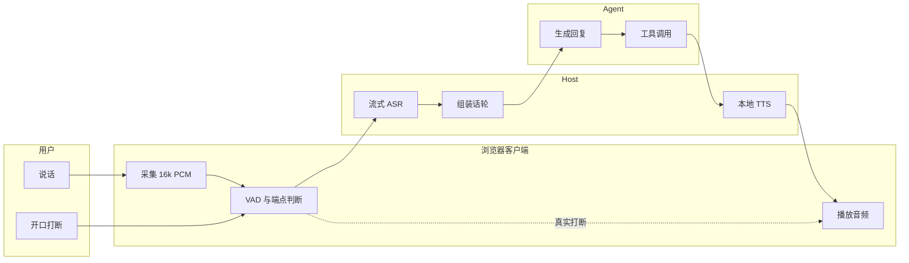

# 产品需求文档 · DSH Voice

**v1.0**　·　2026-11-03　·　草稿（待评审）　·　负责人：虢鹏　·　需求编号 DSH-VOICE　·　优先级 P0

## 变更记录

| 版本 | 日期 | 变更内容 | 修改人 |
|---|---|---|---|
| v1.0 | 2026-11-03 | 初稿 | 虢鹏 |

## 关联与约束

| 字段 | 内容 |
|---|---|
| 关联文档 | [DSH Cordis 入门](https://github.com/deepseek-ai/deepseek-harness/blob/master/docs/cordis-primer.zh.md) · [DSH 能力 Seams](https://github.com/deepseek-ai/deepseek-harness/blob/master/docs/capability-seams.zh.md) · [DSH 语音输入子系统](https://github.com/deepseek-ai/deepseek-harness/blob/master/docs/subsystems/voice-input.zh.md) · [dsh-voice-mode](https://github.com/qishuilalala/dsh-voice-mode)（参考实现，不作为依赖） · VoiceAgent `architecture.md`（本地路径 `~/Developer/Projects/building/voice-local/architecture.md`，音频管线参考） |
| 版本绑定 | 本 PRD 的 DSH API 依赖以 `engines.dsh >=0.2.1-rc.5 <0.3.0-0` 为准。DSH 修改 `ctx.speechToText`、`agent/*` 事件、客户端 Slot 或插件 manifest 后，重新核对第六节 REQ-02、REQ-04、REQ-06、REQ-08、REQ-13。 |
| 对外提供 | 语音会话状态机（REQ-01）与客户端/宿主消息协议（`src/shared/protocol.ts`）；后续领域 pack 复用该状态机与协议。 |

---

## 一、项目背景

DSH 当前的语音能力是实验性语音输入：用户点麦克风，录音，停止后由 Host 的 SenseVoice 模型转写，文字插入草稿，用户再手动发送。识别在 Host CPU 上运行，录音不进入 Session 事件。该能力覆盖听写，不覆盖对话：转写完成前看不到中间结果，Agent 回复不朗读，用户无法在 Agent 说话时插话。

社区插件 `dsh-voice-mode` 提供流式识别、按句朗读和发声打断。它的默认参数是 1.5 秒断句加 1.2 秒静音后发送，合计约 2.7 秒；播放期不持续识别；默认朗读走 Edge 云端。2026-10 的插件目录显示该插件 25 星、8 fork、3 watcher，真实声学环境由用户自行确认。

后果：用户离开键盘时无法用语音完成一轮完整对话，长任务必须回到屏幕；Agent 说话时用户只能等它说完；网络断开或 Edge 朗读握手变化时，语音功能整体不可用。

---

## 二、产品目标

用户离开键盘时，用语音完成一轮完整对话：说话、打断、听回复、下命令，全程留在原地。

| 指标 | 现状 | 目标 | 何时衡量 |
|---|---|---|---|
| 用户停止说话到听到第一个 AI 音节，90 分位 | `dsh-voice-mode` 约 2.7 秒（默认发送参数） | ≤ 1500 毫秒 | v0.1 发布后 2 周 |
| 命令路径（停止 / 继续 / 总结 / 进度），90 分位 | 无 | ≤ 800 毫秒 | v0.1 发布后 2 周 |
| 用户开口打断到 AI 停止播放，90 分位 | 无 | ≤ 300 毫秒 | Phase 0 结束 |
| 误打断率 | 无 | ≤ 5% | v0.1 发布后 2 周 |
| 中文识别字错率 CER | DSH 内置语音输入未公布 | ≤ 10% | v0.1 发布后 2 周 |
| 英文识别词错率 WER | 未公布 | ≤ 15% | v0.1 发布后 2 周 |
| 本地 TTS 首帧，90 分位（预热后） | 未测 | ≤ 300 毫秒 | v0.1 发布后 2 周 |
| 连续语音会话稳定性 | 未测 | 30 分钟无崩溃、无音频泄漏、内存增长 ≤ 100 MB | v0.1 发布后 2 周 |
| 跨设备矩阵 | 未测 | macOS / Windows / Linux × 耳机 / 外放共 6 组通过 | v0.1 发布后 4 周 |

---

## 三、用户分析

| 用户 | 特点 | 痛点 |
|---|---|---|
| 离开键盘的操作者 | 长任务运行中会走动、做饭、通勤；使用笔记本或台式机 | 只能回到屏幕看进度，语音输入要手动按开始和停止 |
| 长任务审阅者 | Agent 一次运行几分钟到几十分钟；看改动、批准操作、打断方向 | 文字输出太长，眼睛离开屏幕就丢失进度；审批弹窗必须点鼠标 |
| 嘈杂环境用户 | 办公室、咖啡厅、共享空间；常用外放 | 外放时 AI 自己的声音被麦克风收进去，打断误触发或识别被污染 |
| 隐私敏感用户 | 企业员工、个人开发者；处理代码和内部资料 | 云端语音服务把音频和文本送出本机；断网后语音功能不可用 |
| 移动 / 远程用户 | 手机或平板连回桌面 DSH | 没有顺手的语音入口，远程时只能看不能听 |

---

## 四、核心场景

| 编号 | 用户 | 场景（何时/何地） | 目标 | 界面交互 | 实现的价值 | 关联需求 |
|---|---|---|---|---|---|---|
| SC-01 | 离开键盘的操作者 | 长任务运行中，人在房间另一头 | 开始一轮语音对话 | 点麦克风或按 `Ctrl+Shift+V`，直接说话 | 不用回到屏幕就能提问 | REQ-01、REQ-02、REQ-03、REQ-04、REQ-05 |
| SC-02 | 长任务审阅者 | Agent 正在朗读一段长回复 | 打断并改方向 | 直接开口说话 | 不用等它说完，方向错了立刻改 | REQ-06、REQ-07 |
| SC-03 | 长任务审阅者 | 离开屏幕几分钟后回来 | 听当前进度 | 说「到哪了」或「总结一下」 | 一句话拿到进度，不用翻聊天记录 | REQ-09 |
| SC-04 | 嘈杂环境用户 | 外放、办公室背景噪声 | 继续用语音 | 系统提示外放风险，自动切按住说话 | 不被自回声打断，识别不被污染 | REQ-07、REQ-12 |
| SC-05 | 隐私敏感用户 | 断网、处理内部代码 | 本地完成语音对话 | 进入语音模式后直接说话 | 音频和文本不出本机 | REQ-11 |
| SC-06 | 移动 / 远程用户 | 手机浏览器连回桌面 DSH | 用手机当麦克风和扬声器 | 手机端进入语音模式 | 远程也能听和说 | REQ-12（v1.2 完整支持） |
| SC-07 | 任意用户 | 结束语音对话 | 回到文字模式 | 点按钮或说「退出语音」 | 不残留麦克风占用和播放 | REQ-01、REQ-12 |

---

## 五、业务流程

### 图型选择

语音会话是单实体多状态，状态之间有条件流转，选**状态图**。一轮对话涉及用户、浏览器客户端、Host、Agent 四个参与方，交接点是音频、文本、工具调用和播放，选**泳道图**。两个图组合覆盖状态与交接，不重复画时序图。

### 图 1 · 语音会话状态

> 图 1 · 语音会话状态流转 · 本文档定义 · 2026-11-03

### 图 2 · 一轮对话的参与方交接

> 图 2 · 一轮对话的四个参与方 · 本文档定义 · 2026-11-03

### 流程分解

| 步骤 | 角色 | 动作 | 系统响应 |
|---|---|---|---|
| 1 | 用户 | 进入语音模式并说话 | 客户端采集 16k PCM，VAD 判定语音起点 |
| 2 | 客户端 | 持续送音频帧 | Host 流式 ASR 返回中间文本，字幕实时更新 |
| 3 | 客户端 | 检测到静音与文本完整 | 组装话轮，发送给 Agent 或插话 |
| 4 | Agent | 生成回复或调用工具 | Host 按句切分，本地 TTS 合成 |
| 5 | 客户端 | 播放音频 | 字幕跟随，VAD 持续监听 |
| 6 | 用户 | 开口打断 | 客户端停止播放，缓冲最近 2 秒音频并回灌 ASR |
| 7 | 客户端 | 播放完成或退出 | 回到聆听态或释放麦克风 |

---

## 六、具体需求

| 编号 | 模块 | 名称 | 配图 | 说明 |
|---|---|---|---|---|
| REQ-01 | 入口与状态 | 语音模式入口、退出与状态 | 无界面截图；入口在输入框右侧麦克风按钮，状态条在输入框上方 | **规则**　输入框右侧显示麦克风按钮。点击按钮或按 `Ctrl+Shift+V`（macOS 为 `Cmd+Shift+V`）进入语音模式。同一浏览器窗口同一时刻只有一个会话处于语音模式。进入后按钮进入聆听态，输入框上方显示状态条。点击按钮、按同一快捷键或说「退出语音」退出。退出时停止采集、停止播放、保留草稿，麦克风轨道在 1 秒内释放。  **分支** 1. 已进入语音模式，再点按钮 → 退出语音模式。 2. 切换到另一个会话 → 当前会话退出语音模式，新会话保持文字模式。 3. 麦克风权限被拒绝 → 保持文字模式，显示权限错误。 4. 页面隐藏超过 1 秒 → 停止采集和播放，回到 Idle，保留草稿。 5. 另一个窗口已经占用语音模式 → 后进入的窗口显示占用提示，不采集。  **文案** · 按钮悬停：语音模式 · 权限拒绝：麦克风权限被拒绝，请在浏览器设置中允许后重试 · 占用提示：另一个窗口正在使用语音模式  **验收** 1. 点击按钮后 200 毫秒内按钮进入聆听态。 2. 快捷键与点击按钮的行为一致。 3. 切换会话后原会话退出语音模式，新会话不自动进入。 4. 页面隐藏 1 秒后麦克风轨道停止，草稿内容不丢失。 |
| REQ-02 | 音频与识别 | 流式采集与流式识别 | 无界面截图；状态条显示「聆听中 / 识别中」 | **规则**　客户端以 16 kHz、单声道、PCM16 采集音频，每 20 毫秒送一帧到 Host。Host 运行本地流式 ASR，中间文本每 300 毫秒至少更新一次，端点确定后返回最终文本。默认语言为自动，可选中文、英文。模型首次使用前完成加载，加载完成后才允许进入语音模式。  **分支** 1. 模型未就绪 → 按钮禁用，显示准备进度；准备完成后自动恢复。 2. 用户说话 500 毫秒内没有中间文本 → 状态条显示「识别中」，不插入空文本。 3. 识别结果为空或只有语气词 → 不发送，显示「没听清，再说一遍」。 4. ASR 连续 5 秒没有返回 → 结束本轮，保留最近 2 秒音频供重试。 5. 断网 → 本地 ASR 和本地 TTS 继续工作，不切换云端。  **文案** · 准备中：正在准备本地语音模型… · 空结果：没听清，再说一遍 · 不可用：语音识别暂时不可用，请改用文字  **验收** 1. 中文测试集 CER ≤ 10%，英文测试集 WER ≤ 15%。 2. 用户开口到第一个中间文本 ≤ 500 毫秒。 3. 端点确定到最终文本 ≤ 800 毫秒。 4. 连续 30 分钟识别，进程内存增长 ≤ 100 MB。 |
| REQ-03 | 音频与识别 | 判断说完与端点 | 无界面截图；状态条显示「聆听中 / 正在判断」 | **规则**　客户端用 Silero VAD 检测语音起点和静音。命令模式静音阈值 500 毫秒，对话模式静音阈值 1200 毫秒。静音达到阈值且文本完整时提交；文本以「因为、然后、就是」等连接词结尾时延长 400 毫秒，最多延长 2 次。单轮从首次检测到静音起总等待上限 3000 毫秒，达到上限立即提交。短句（≤ 4 个汉字）跳过延长，直接进入提交确认。  **分支** 1. 静音 ≥ 阈值且文本完整 → 提交。 2. 静音 ≥ 阈值且文本以连接词结尾 → 延长 400 毫秒，最多 2 次。 3. 用户恢复说话 → 取消待提交，继续识别。 4. 总等待超过 3000 毫秒 → 强制提交。 5. 文本为空 → 不提交，回到聆听态。  **文案** · 聆听中：聆听中… · 判断中：正在判断…  **验收** 1. 短句（≤ 4 个汉字）从静音到提交 ≤ 700 毫秒。 2. 长句从静音到提交 ≤ 1500 毫秒。 3. 用户恢复说话时取消率 100%，不产生半句提交。 4. 测试集截断率 ≤ 5%。 |
| REQ-04 | 会话 | 发送与插话 | 无界面截图；状态条显示「思考中 / 已插话」 | **规则**　最终文本在 Agent 空闲时通过 `followup` 发送；Agent 运行中通过 `steer` 插话；`steer` 不可用时进入排队并提示。审批待处理时，语音文本先进入命令路由，不直接发起新话轮。相同文本在 2 秒内重复出现时只发送一次。  **分支** 1. Agent 空闲 → `followup` 发送。 2. Agent 运行中 → `steer` 插话；成功后状态条显示「已插话」。 3. `steer` 失败 → 进入排队，提示「当前任务运行中，已排队」。 4. 审批待处理 → 交给命令路由处理批准或拒绝。  **文案** · 已插话 · 已排队：当前任务运行中，已排队  **验收** 1. 最终文本到发送调用 ≤ 100 毫秒。 2. `steer` 成功率 ≥ 95%。 3. 2 秒内重复文本只发送一次。 |
| REQ-05 | 本地朗读 | 本地 TTS 与按句播放 | 无界面截图；设置页提供音色、语速、音量 | **规则**　Host 使用本地 TTS 模型合成，默认不调用云端。LLM 每输出一句，TTS 立即合成并播放；播放当前句时预合成下一句。一轮对话使用同一个 TTS 会话，通话级锁定音色、语速、情绪参数。朗读前剥离 Markdown、代码块、表格和链接。代码块跳过并提示「这一段代码已跳过」。代码术语按内置词典发音。  **分支** 1. TTS 模型未就绪 → 只显示字幕，提示「本地语音模型未就绪，已切换到字幕」。 2. 单句合成失败 → 跳过该句，继续下一句，记录错误。 3. 单句超过 200 个字符 → 在句末标点切分，每段最多 2 句。 4. 用户在一轮中修改音色或语速 → 下一轮生效，本轮不变。 5. 代码块 → 跳过，不朗读。  **文案** · 模型未就绪：本地语音模型未就绪，已切换到字幕 · 跳过代码：这一段代码已跳过  **验收** 1. 第一句文本到第一个音频帧 ≤ 300 毫秒（预热后，90 分位）。 2. 相邻句播放间隔 ≤ 200 毫秒。 3. 连续朗读 10 分钟，音色、语速不漂移，句尾不截断。 4. 代码块朗读次数为 0。 |
| REQ-06 | 打断 | 真打断与音频回灌 | 无界面截图；状态条显示「已打断」 | **规则**　播放期间 VAD 持续监听。用户真实说话连续 ≥ 150 毫秒且能量高于回声门限时，客户端在 300 毫秒内停止播放，保留最近 2 秒麦克风音频，回灌给已重置的 ASR，然后进入聆听态。AI 说话期间不把麦克风音频送入流式 ASR，避免 AI 自己的声音污染识别缓存。  **分支** 1. 用户真实说话 → 停止播放，回灌最近 2 秒音频，进入聆听态。 2. 用户只说「嗯 / 对 / 好」等让位词 → 不停止播放，按 REQ-07 处理。 3. 外放且没有回声消除 → 提示戴耳机；连续 2 次误打断后切换到按住说话。 4. 打断后 500 毫秒内没有识别文本 → 回到聆听态，不重复播放上一句。  **文案** · 已打断：已打断，请说 · 外放提示：外放可能误打断，请戴耳机  **验收** 1. 用户开口到停止播放 ≤ 300 毫秒（90 分位）。 2. 误打断率 ≤ 5%。 3. 打断文本保留率 ≥ 95%。 4. 打断后不出现 AI 自己声音被识别成用户文本。 |
| REQ-07 | 打断 | 让位与误打断抑制 | 无界面截图 | **规则**　内置让位词表：嗯、啊、哦、对、好、是的、行。让位词不超过 2 个汉字时，不停止播放，不进入 ASR。同一轮让位最多 1 次，两次让位间隔至少 3 秒。让位词后 1.5 秒内用户继续说话，按真实打断处理。  **分支** 1. 命中让位词且长度 ≤ 2 个汉字 → 继续播放。 2. 让位词后 1.5 秒内继续说话 → 真实打断。 3. 非让位词 → 真实打断。  **文案** · 无用户可见文案。  **验收** 1. 让位词导致的误打断率 ≤ 5%。 2. 真实打断识别率 ≥ 95%。 3. 同一轮让位词最多触发 1 次。 |
| REQ-08 | 界面 | 实时字幕 | 输入框上方字幕区 | **规则**　字幕显示中间文本和最终文本。中间文本用浅色，最终文本用正常色。字号 3 档（14 / 18 / 24 像素），宽度 3 档（50 / 70 / 90 百分比）。代码块和表格不显示在字幕中。字幕最多显示 2 行，超出后滚动。屏幕阅读器只播报状态变化，不播报每个中间文本。  **分支** 1. 用户关闭字幕 → 只保留状态条。 2. 中间文本超过 2 行 → 滚动到最新一行。 3. 屏幕阅读器开启 → 只播报「聆听中 / 思考中 / 朗读中 / 已打断」。  **文案** · 关闭字幕：字幕已关闭 · 状态：聆听中、思考中、朗读中、已打断  **验收** 1. 中间文本到字幕显示 ≤ 300 毫秒。 2. 字幕出现不导致输入框布局跳动。 3. 字幕对比度满足 WCAG AA。 |
| REQ-09 | 命令 | 通用语音命令 | 无界面截图；命令提示可显示在状态条 | **规则**　内置命令：停止、继续、总结、进度、退出语音。命令路由先做规则匹配，匹配不到时用本地小模型做意图分类；置信度低于 0.8 时反问一次。命令路径不经过 Agent 生成，直接执行，目标延迟 ≤ 800 毫秒。命令文本不进入普通对话历史。  **分支** 1. 命中命令 → 直接执行。 2. 未命中命令且置信度 ≥ 0.8 → 按普通消息发送。 3. 置信度 < 0.8 → 反问「你是想让我停下来，还是继续？」。 4. 连续 2 次无法识别 → 提示可用命令列表。  **文案** · 反问：你是想让我停下来，还是继续？ · 命令列表：可用命令：停止、继续、总结、进度、退出语音  **验收** 1. 20 条命令测试集准确率 ≥ 95%。 2. 命令路径 90 分位 ≤ 800 毫秒。 3. 普通说话不误触发命令。 |
| REQ-10 | 设置 | 语音设置 | 设置页「语音」卡片 | **规则**　设置项：音色、语速（0.8–1.2 倍）、端点灵敏度（低 / 中 / 高）、语言（自动 / 中文 / 英文）、快捷键、字幕开关、输入设备。设置通过 `ctx.settings` 持久化。音色和语速下一轮生效；端点灵敏度和字幕立即生效；输入设备切换后重新采集。  **分支** 1. 值超出范围 → 收敛到最近边界值。 2. 输入设备被拔出 → 切回系统默认并提示。 3. 插件版本升级 → 读取旧设置，缺失字段用默认值补齐。  **文案** · 设备不可用：麦克风不可用，已切换到系统默认设备 · 设置已保存：设置已保存  **验收** 1. 设置重启 DSH 后保留。 2. 修改音色后下一轮生效，当前轮不改变。 3. 输入设备拔出后 1 秒内切回默认设备。 |
| REQ-11 | 隐私 | 本地模式与数据边界 | 设置页「隐私」区块 | **规则**　默认使用本地 ASR 和本地 TTS。音频字节不离开 Host 所在机器。转写完成后不保存音频文件，只保留当前会话的文本草稿。云端识别和云端合成默认关闭，企业配置显式开启后才可用。诊断日志不包含音频、转写原文和凭据。  **分支** 1. 首次使用本地模型 → 联网下载模型；下载完成后可离线使用。 2. 企业配置开启云端 → 设置页显示「云端模式」，每次进入语音模式前提示一次。 3. 用户卸载插件 → 模型缓存保留，设置页提供「删除本地模型」按钮。  **文案** · 本地模式：本地模式：音频不会离开这台电脑 · 云端提示：云端模式会把音频发送到配置的服务商  **验收** 1. 本地模式下抓包，音频字节发送到外部地址的数量为 0。 2. 本地模式断网后语音对话可用。 3. 诊断日志中不出现转写原文和音频路径。 |
| REQ-12 | 稳定性 | 跨设备降级与错误恢复 | 状态条显示降级原因 | **规则**　启动时检测浏览器原生回声消除是否生效。外放且回声消除未生效时，提示戴耳机；连续 2 次误打断后自动切换到按住说话。ASR、TTS、Agent、WebSocket、麦克风任一环节失败时，状态机回到 Idle，保留草稿，显示具体错误，提供重试按钮。  **分支** 1. 外放且无回声消除 → 提示戴耳机，不自动降级。 2. 连续 2 次误打断 → 自动切换到按住说话。 3. ASR 失败 → 保留最近 2 秒音频，显示重试。 4. TTS 失败 → 跳过该句，继续播放后续句子。 5. WebSocket 断开 → 3 秒内重连；重连失败回到 Idle。  **文案** · 外放：检测到外放，请戴耳机 · 降级：已切换到按住说话 · 重试：语音暂时不可用，点击重试  **验收** 1. 6 组设备矩阵（macOS / Windows / Linux × 耳机 / 外放）全部通过。 2. 任一错误发生后 1 秒内状态回到 Idle。 3. 错误恢复后草稿不丢失。 4. 不出现卡在聆听态或播放态无法退出的情况。 |
| REQ-13 | 安装 | 插件安装、升级与卸载 | 无界面截图；DSH 插件管理页 | **规则**　插件以 npm 包发布，安装命令 `dsh plugin --profile web add @dsh-voice/voice`。`package.json` 声明 `engines.dsh >=0.2.1-rc.5 <0.3.0-0`。首次进入语音模式前检查本地模型，缺失时引导下载并校验 SHA-256。卸载插件后释放麦克风、停止播放、移除插件条目，模型缓存保留。  **分支** 1. DSH 版本不在范围内 → 拒绝加载，显示版本要求。 2. 模型下载失败 → 显示失败文件和下载源，提供重试。 3. 插件升级 → 保留设置和模型缓存。 4. 卸载 → 释放资源，保留模型缓存，设置页提供清理入口。  **文案** · 版本不支持：当前 DSH 版本不受支持，仅支持 0.2.1-rc.5 及以上 · 下载失败：模型下载失败，点击重试  **验收** 1. 全新安装到可用 ≤ 10 分钟（网络正常，模型下载完成）。 2. 卸载后麦克风轨道和播放队列释放。 3. DSH 版本不在范围内时插件不加载，DSH 不崩溃。 |

**本期不做**

| 不做 | 档位 | 理由 | 什么时候重新评估 |
|---|---|---|---|
| 编码领域 pack（读 diff、读测试、读报错） | 推迟 | 本期先交付通用语音核心；领域 pack 依赖通用命令路由稳定 | v0.2 |
| 语音审批（批准 / 拒绝工具调用） | 推迟 | 语音审批依赖 `ctx.approval` 的语音应答流程，放在 v0.2 | v0.2 |
| 唤醒词 | 推迟 | 唤醒词的误唤醒和待机段状态机增加复杂度，先保证按住说话和持续聆听 | v1.1 |
| 手机远程 | 推迟 | 手机远程依赖移动端 UI 和配对，放在 v1.2 | v1.2 |
| 语音克隆 | 推迟 | 音色克隆涉及授权和模型训练，放在 v2 | v2 |
| 云端 ASR / TTS | 拒绝 | 默认产品走本地，隐私边界是核心承诺；企业云端版本另立 PRD | 企业版立项时 |
| 多人会议 / 会议纪要 | 拒绝 | 本期面向单人语音对话，多人分离依赖独立的说话人分离与会议模型 | 不做 |
| 数字人 / 视频 | 拒绝 | 与语音对话无关 | 不做 |
| 主题 / 皮肤 | 拒绝 | 与语音能力无关 | 不做 |

---

## 七、数据埋点（统计需求）

| 编号 | 模块 | 指标名称 | 事件 | 指标描述（计算公式） | 现状 | 目标 |
|---|---|---|---|---|---|---|
| M-01 | 会话 | 语音会话数 | `voice_session_start` | 进入语音模式的次数 | 0 | 上线后按周统计 |
| M-02 | 会话 | 完成话轮数 | `voice_turn_end` | 播放完成或被真实打断的轮数 | 0 | 上线后按周统计 |
| M-03 | 延迟 | 感知延迟 | `voice_first_audio_played` | 第一个音频帧实际播放时刻 − 用户最后语音帧时刻 | 未测 | 90 分位 ≤ 1500 毫秒 |
| M-04 | 延迟 | 打断停止延迟 | `voice_barge_in_stopped` | 播放停止时刻 − 用户打断语音起点 | 未测 | 90 分位 ≤ 300 毫秒 |
| M-05 | 质量 | 误打断率 | `voice_barge_in_false` | 误停止次数 ÷ 打断尝试次数 | 未测 | ≤ 5% |
| M-06 | 质量 | 中文识别字错率 | `voice_asr_final` | 编辑距离 ÷ 参考文本长度 | 未测 | ≤ 10% |
| M-07 | 质量 | 命令准确率 | `voice_command_result` | 正确执行命令数 ÷ 命令总数 | 未测 | ≥ 95% |
| M-08 | 延迟 | 本地 TTS 首帧 | `voice_tts_first_frame` | 第一个音频帧时刻 − 第一句文本时刻 | 未测 | 90 分位 ≤ 300 毫秒 |
| M-09 | 稳定性 | 降级次数 | `voice_fallback_ptt` | 自动切换到按住说话的次数 | 0 | 按周统计 |
| M-10 | 稳定性 | 错误次数 | `voice_error` | 按错误类型分组的次数 | 0 | 按周统计 |

> 所有指标默认本地统计，不上传。用户显式开启诊断上报后才发送聚合值，不发送音频和转写原文。

---

## 八、风险评估

| 编号 | 风险名称 | 场景描述 | 风险级别 | 如何规避 |
|---|---|---|---|---|
| RK-01 | 外放自回声导致误打断 | 用户用扬声器，AI 的声音被麦克风收进去，VAD 判成用户说话 | 高 | 浏览器原生回声消除 + 残余回声门限 + 外放提示 + 连续 2 次误打断切换按住说话 |
| RK-02 | 让位词误判 | 用户说「嗯」被当成打断，或真打断被当成让位 | 中 | 让位词表 + 2 字上限 + 1.5 秒续说判定 + 误打断率埋点 |
| RK-03 | 嘈杂环境识别率下降 | 办公室、咖啡厅背景噪声导致 CER 上升 | 高 | VAD 阈值可调 + 按住说话降级 + 噪声下专项测试集 |
| RK-04 | 本地 TTS 首帧慢 | 模型冷启动、显存不足、句子过长 | 高 | 预热 + 句级合成 + 下一句预合成 + 模型量化 + 字幕兜底 |
| RK-05 | DSH 插件 API 变化 | `ctx.speechToText`、`agent/*` 事件、Slot 在 DSH 升级后改名或改签名 | 中 | `engines.dsh` 版本区间 + 兼容测试 + 适配层隔离 |
| RK-06 | 跨设备差异 | macOS、Windows、Linux 的麦克风、回声消除、浏览器实现不同 | 高 | 6 组设备矩阵 + 自动降级 + 真实设备验收 |
| RK-07 | 隐私泄漏 | 音频或转写文本被日志、崩溃报告、云端服务带走 | 高 | 本地默认 + 日志脱敏 + 抓包验收 + 云端显式开启 |
| RK-08 | 分发不足 | 插件没有被市场收录，用户看不到 | 中 | npm + DSH 插件市场 + 中英文 README + 30 秒演示 |
| RK-09 | 现有插件竞争 | `dsh-voice-mode` 迭代快，先补上真全双工 | 中 | 以真全双工、低延迟、跨设备、本地 TTS 为差异；不在功能数量上竞争 |

**回滚方案**

| 项 | 内容 |
|---|---|
| 触发条件 | v0.1 发布后 2 周，感知延迟 90 分位 > 2000 毫秒，或误打断率 > 10%，或崩溃率 > 1% |
| 回滚方式 | 关闭插件开关，回退到文字模式；保留设置和草稿；npm 发布上一稳定版本 |
| 数据处理 | 本地统计和诊断数据保留在用户机器；不上传音频和转写原文 |
| 回滚耗时 | 插件开关 1 分钟内生效；npm 版本回退 10 分钟内完成 |

---

## 九、迭代计划

| 期次 | 计划内容 | 对本期的影响（要预留什么） |
|---|---|---|
| Phase 0（1 周，开发前可行性门） | 真全双工音频处理流程可行性验证：流式 ASR + 本地 TTS + AEC + 打断，3 台设备测延迟 | 不发布产品；验证不通过就停止。预留 `VoiceSession` 状态机接口和 `TtsProvider` 接口 |
| 本期 v0.1（2–3 周） | 通用语音核心：入口、流式识别、端点、发送/插话、本地朗读、真打断、让位、字幕、设置、隐私、跨设备降级、插件安装 | 预留命令路由接口 `VoiceCommandRouter`、领域 pack 接口 `VoicePack`、审批桥接口 `ApprovalBridge` |
| 下一期 v0.2（2–3 周） | 语音命令扩展、语音审批、编码 pack（读 diff / 测试 / 报错） | 预留 `VoicePack` 的生命周期与权限边界；审批桥接 `ctx.approval` |
| v1.0（发布版） | 插件市场上架、手机远程、语音克隆、更多语言 | 预留移动端配对协议、音色 provider 接口 |
| v1.1 / v1.2 | 唤醒词、多人会议、企业云端版本 | 唤醒词预留待机段状态；云端版本另立 PRD |

---

## 待确认

| # | 问题 | 影响什么 | 责任人 | 截止 |
|---|---|---|---|---|
| D-01 | 流式 ASR 选 zipformer2 还是 SenseVoice 流式方案 | REQ-02 的模型、包体积、CER | 虢鹏 | 2026-11-10 |
| D-02 | 本地 TTS 选 CosyVoice 还是 VITS / Kokoro 作为默认 | REQ-05 的首帧、音色、安装体积 | 虢鹏 | 2026-11-10 |
| D-03 | 客户端入口用 `conversation.input.activity` 还是 `conversation.input.right` | REQ-01、REQ-08 的 Slot 与布局 | 虢鹏 | 2026-11-10 |
| D-04 | 6 组跨设备矩阵的具体机器和浏览器版本 | REQ-12 的验收环境 | 虢鹏 | 2026-11-10 |
| D-05 | npm 包名与 scope（`@dsh-voice/voice` 是否可用） | REQ-13 的安装命令与发布 | 虢鹏 | 2026-11-10 |
