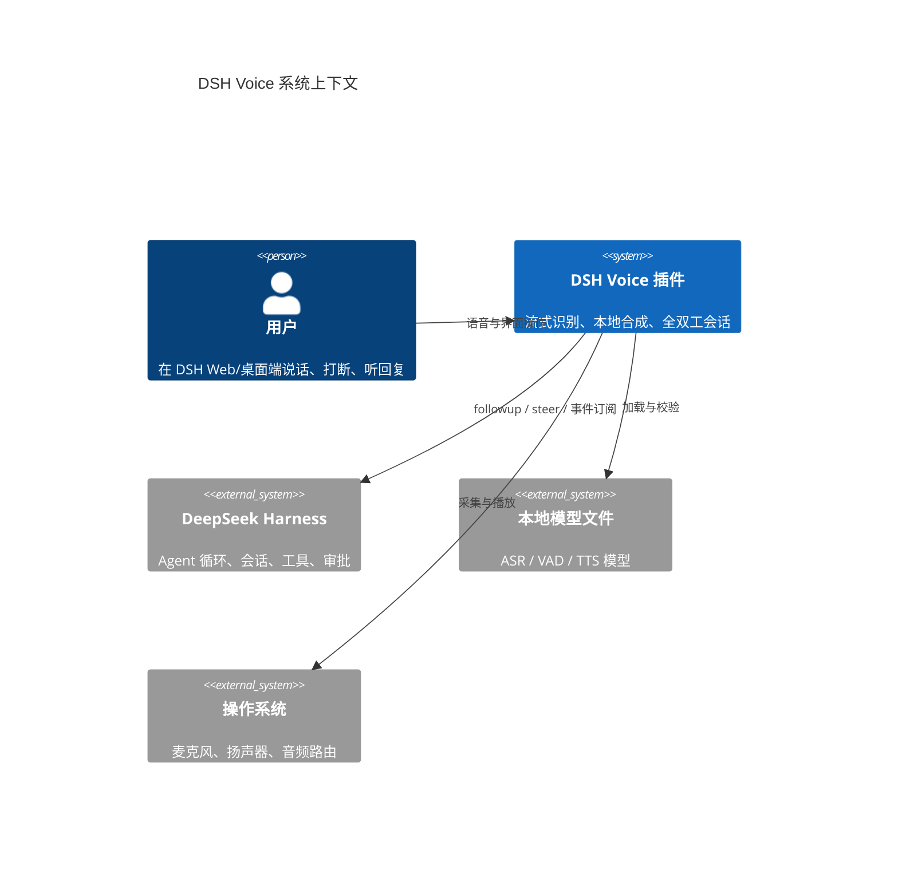
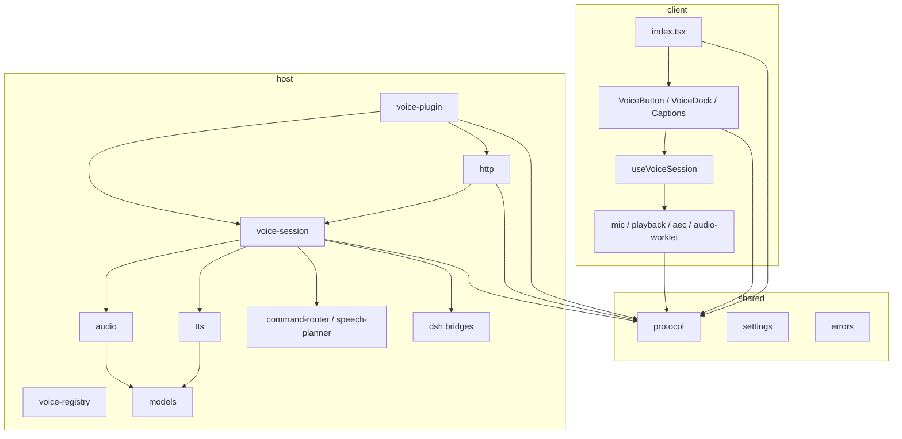
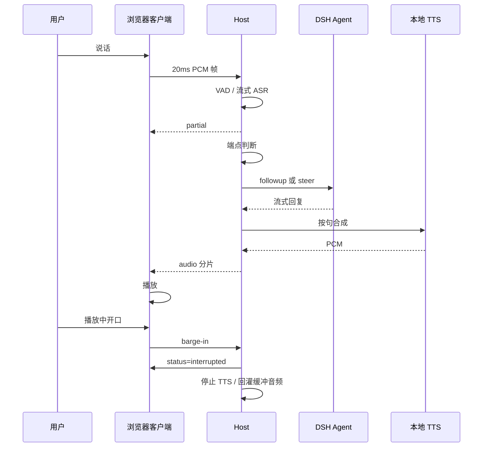
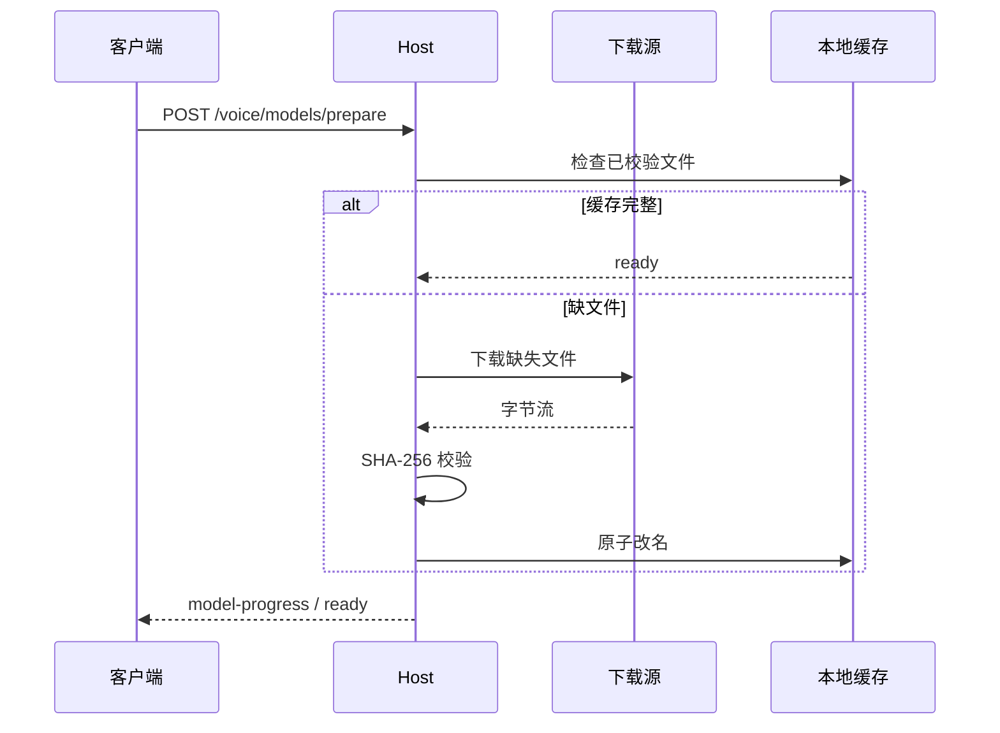
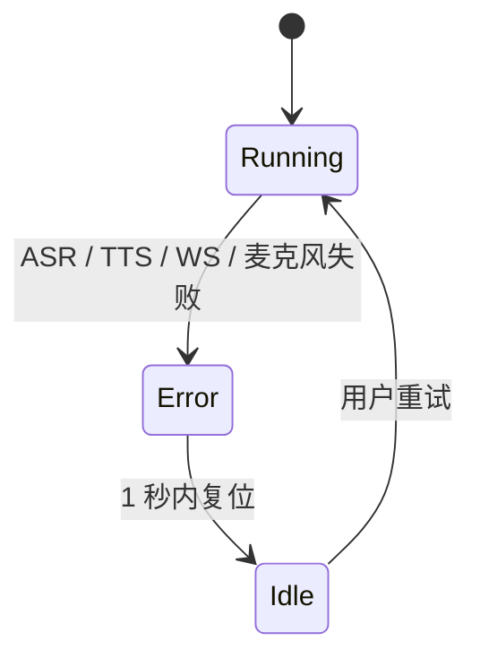

# 技术方案 · DSH Voice

| 版本 | 日期 | 状态 | 负责人 | 需求编号 | 骨架 |
|---|---|---|---|---|---|
| v1.0 | 2026-11-03 | 草稿（待评审） | 虢鹏 | DSH-VOICE | arc42 + C4 |

## 变更记录

| 版本 | 日期 | 变更内容 | 修改人 |
|---|---|---|---|
| v1.0 | 2026-11-03 | 初稿 | 虢鹏 |

## 关联与约束

| 字段 | 内容 |
|---|---|
| 文档结构 | 遵循 arc42 十二节，增补「测试策略」「本地开发与 CI/CD」「开发顺序」三节；领域相关章节为第九节音频处理过程与第十节 DSH 集成 |
| 关联文档 | [PRD v1.0](PRD.md)。产品规则以 PRD 为准，本文档只引用需求编号，不重复描述规则 |
| 版本绑定 | DSH 插件接口以 `engines.dsh >=0.2.1-rc.5 <0.3.0-0` 为准；`@deepseek-ai/cordis 4.0.5`；`sherpa-onnx-node 2.0.1`。DSH 或 Cordis 升版后重新核对第四节、第六节、第十节 |
| 对外提供 | `VoiceSession` 状态机、Host/Client 消息协议（`src/shared/protocol.ts`）、`VoicePack` 领域扩展接口；领域 pack 复用这些契约 |

## 怎么读这份文档

| 读者意图 | 读哪几节 |
|---|---|
| 第一次接手 | 一、二、三、四、十七 |
| 写音频模块 | 四、七、九、十一 |
| 写 DSH 集成 | 四、六、十、十四 |
| 想知道为什么这么选 | 三、十四、十五 |
| 要部署或发布 | 十二、十三、十五 |

---

## 一、目标、质量属性与约束

系统目标：在 DSH Web/桌面端提供通用全双工语音对话，音频在本机完成识别与合成，用户开口即可打断 Agent 的朗读。

### 1.1 SLO

| 场景 | 度量 | 目标 | 超标时怎么办 |
|---|---|---|---|
| 感知延迟 | 用户最后语音帧到第一个音频帧实际播放 | 90 分位 ≤ 1500 毫秒 | 检查 VAD 静音窗口、EOU 延长、ASR final、TTS 首帧；逐段回放定位 |
| 命令路径 | 命令文本到命令执行 | 90 分位 ≤ 800 毫秒 | 关闭 LLM 意图兜底，走纯规则；检查命令路由表 |
| 打断停止 | 用户打断语音起点到播放停止 | 90 分位 ≤ 300 毫秒 | 降低 VAD 确认帧数；检查回声门限和播放缓冲 |
| 误打断率 | 误停止次数 ÷ 打断尝试次数 | ≤ 5% | 提高回声门限；启用让位词；切换按住说话 |
| 中文识别 | 测试集字错率 CER | ≤ 10% | 换 zipformer2 模型；加领域热词；检查采样率 |
| 英文识别 | 测试集词错率 WER | ≤ 15% | 切换多语言模型；检查语言提示 |
| 本地 TTS 首帧 | 第一句文本到第一个音频帧 | 90 分位 ≤ 300 毫秒 | 预合成下一句；换量化模型；检查显存 |
| 连续会话 | 30 分钟内的崩溃、音频泄漏、内存增长 | 崩溃 0 次；音频泄漏 0 次；内存增长 ≤ 100 MB | 回收 ASR/TTS 工作进程；检查队列上限 |
| 跨设备 | 6 组设备矩阵通过率 | 6 / 6 | 降级为按住说话；记录设备与浏览器版本 |

硬指标：本地模式下音频字节发送到外部地址的数量为 0；代码块朗读次数为 0；打断后 AI 自己声音被识别成用户文本的次数为 0。

### 1.2 约束

| 类型 | 约束 | 对架构的影响 |
|---|---|---|
| 组织 | 一人开发，无专职音频测试 | 测试台自动化；真实设备矩阵靠脚本和自测清单 |
| 合规 | 默认本地处理，音频不出机器 | ASR/TTS 在 Host 本地运行；云端 provider 默认关闭 |
| 技术 | DSH 插件运行在 Node 24.9+，浏览器端 React | Host/Client 两个 aggregate；Native 依赖要覆盖 macOS/Windows/Linux |
| 技术 | DSH 插件 API 处于 0.2.x | 所有 DSH 调用集中在 `src/host/dsh/` 适配层，禁止散落 |
| 技术 | 现有 `dsh-voice-mode` 使用 MIT，参考其音频经验 | 新写实现；只借鉴算法与测试方法，不复制代码 |

### 1.3 非目标

| 非目标 | 理由 |
|---|---|
| 领域 pack（读 diff、读测试、读报错） | v0.2 实现，本期只保留 `VoicePack` 接口 |
| 语音审批 | v0.2 实现，本期保留 `ApprovalBridge` 接口 |
| 唤醒词 | v1.1 实现，本期只支持按住说话和持续聆听 |
| 手机远程 | v1.2 实现，本期只支持同一浏览器窗口 |
| 语音克隆 | v2 实现，本期只提供内置音色 |
| 云端 ASR/TTS | 默认产品不提供；企业版本另立 PRD |
| 多人会议 | 依赖说话人分离与会议模型，与本期单人对话无关 |
| 数字人、视频、主题皮肤 | 与语音对话无关 |

---

## 二、系统上下文



> 图 1 · 系统上下文 · 本文档定义 · 2026-11-03

### 2.1 外部接口

| 外部依赖 | 接口 | 超时 | 失败影响 | 降级 |
|---|---|---|---|---|
| DSH Agent | `followup` / `steer` / `agent/*` 事件 | 发送 2 秒 | 话轮发不出去 | 保留草稿，提示重试 |
| DSH 设置 | `ctx.settings` | 1 秒 | 设置读写失败 | 使用内存默认值 |
| DSH Web 服务器 | `ctx.webServer` 路由与 upgrade | 连接 3 秒 | 客户端连不上 Host | 显示连接错误，重连 |
| 本地 ASR 模型 | `sherpa-onnx-node` 流式识别 | 首 partial 500 毫秒 | 听不清、无法提交 | 提示重试，切换按住说话 |
| 本地 TTS 模型 | `sherpa-onnx-node` 合成 | 首帧 300 毫秒 | 没有声音 | 只显示字幕 |
| 麦克风 | `getUserMedia` | 授权 10 秒 | 无法采集 | 保持文字模式 |
| 模型下载源 | HTTPS 下载 | 单文件 120 秒 | 首次安装失败 | 切换镜像源，离线目录 |

---

## 三、解决方案策略

### 3.1 质量目标与手段

| 质量目标 | 手段 | ADR |
|---|---|---|
| 真全双工 | 浏览器 AEC + 残余回声门限 + Host 侧 VAD + 打断帧回灌 | ADR-04 |
| 低延迟识别 | `sherpa-onnx-node` 流式 zipformer2，Host 本地推理 | ADR-02 |
| 低延迟合成 | 按句合成、下一句预合成、Matcha/Kokoro 模型常驻 | ADR-03 |
| 多会话隔离 | 每个 Session 一个 `VoiceSession`，不共享可变状态 | ADR-05 |
| 本地隐私 | 音频只在 Host 与浏览器之间传输，不落盘、不出机器 | ADR-03、ADR-08 |
| DSH 集成 | Cordis 插件 + Host/Client 分层 + Slot | ADR-01 |
| 可恢复 | 统一错误码、状态机回到 Idle、草稿保留 | 第七节、第八节 |

### 3.2 版本锁定

| 依赖 | 版本 | 用途 | 备注 |
|---|---|---|---|
| Node.js | 24.9.0 | Host 运行时 | DSH 最低要求 |
| `@deepseek-ai/cordis` | 4.0.5 | 插件框架 | 精确版本，禁用 `^` |
| `sherpa-onnx-node` | 2.0.1 | 流式 ASR、VAD、TTS | 原生模块，三平台预编译 |
| `onnxruntime-node` | 1.31.1 | 仅在 `sherpa-onnx-node` 未覆盖时使用 | 无直接依赖则删除 |
| `react` | DSH Client 提供的版本 | Client UI | 以 DSH peer 为准，不单独锁定 |
| `dsh` | `>=0.2.1-rc.5 <0.3.0-0` | Host | `engines.dsh` |

依赖写入 `package.json` 时使用精确版本。CI 增加检查：`package.json` 中出现 `^` 或 `~` 即失败。

### 3.3 被否决的方案

| 方案 | 否决理由 | 详见 |
|---|---|---|
| fork `dsh-voice-mode` | 继承其全局单活、半双工打断和 Edge 云端依赖；后续改动受上游结构限制 | ADR-07 |
| 直接用 DSH 内置 `ctx.speechToText` | 该服务是录音后转写，不支持流式与播放期持续识别 | ADR-02 |
| 云端 ASR/TTS | 与本地隐私承诺冲突 | ADR-03 |
| 单一全局语音会话 | 多标签页、多会话会互相抢占 | ADR-05 |
| HTTP 轮询音频 | 延迟高、上行帧抖动大 | ADR-06 |

---

## 四、代码结构

### 4.1 仓库目录树

```
dsh-voice/
├── package.json                       # workspace 根，脚本与 engines
├── pnpm-workspace.yaml                # packages/*
├── tsconfig.base.json                 # 共享编译选项
├── .gitignore
├── README.md
├── docs/
│   ├── PRD.md                         # 产品规则唯一来源
│   ├── TECH-SPEC.md                   # 本文档
│   ├── adr/                           # 决策正本
│   │   ├── ADR-01-cordis-plugin.md
│   │   ├── ADR-02-streaming-asr.md
│   │   ├── ADR-03-local-tts.md
│   │   ├── ADR-04-aec-barge-in.md
│   │   ├── ADR-05-per-session.md
│   │   ├── ADR-06-websocket-audio.md
│   │   ├── ADR-07-no-fork.md
│   │   └── ADR-08-settings-models.md
│   └── qa/
│       ├── device-matrix.md            # 6 组设备清单与结果
│       └── latency.md                  # S1–S5 测量方法
├── packages/
│   └── voice/
│       ├── package.json                # dsh.bundle.patch / dsh.client.inject / engines.dsh
│       ├── cordis.patch.yml            # 插入 dsh-voice 条目
│       ├── tsconfig.json               # Host aggregate
│       ├── tsconfig.client.json        # Client aggregate
│       ├── build.mjs                   # tsdown 构建
│       ├── src/
│       │   ├── index.ts                # Host 入口 apply(ctx)
│       │   ├── host/
│       │   │   ├── voice-plugin.ts     # 插件装配：服务、设置、路由、命令
│       │   │   ├── voice-session.ts    # 单会话状态机
│       │   │   ├── voice-registry.ts   # sessionId -> VoiceSession
│       │   │   ├── dsh/
│       │   │   │   ├── agent-bridge.ts # followup / steer
│       │   │   │   ├── event-bridge.ts # agent/* 事件订阅
│       │   │   │   ├── settings.ts     # ctx.settings 适配
│       │   │   │   └── commands.ts     # ctx.commands 注册
│       │   │   ├── audio/
│       │   │   │   ├── audio-ingress.ts# 音频帧入口与背压
│       │   │   │   ├── vad.ts          # Silero VAD
│       │   │   │   ├── asr.ts          # 流式 ASR 封装
│       │   │   │   ├── eou.ts          # 端点规则
│       │   │   │   ├── aec.ts          # 回声门限与参考信号
│       │   │   │   └── resample.ts     # 16k/48k 转换
│       │   │   ├── tts/
│       │   │   │   ├── tts-service.ts  # provider 注册与轮次队列
│       │   │   │   ├── tts-provider.ts # 统一接口
│       │   │   │   ├── sherpa-tts.ts   # Matcha / Kokoro / VITS
│       │   │   │   ├── segmenter.ts    # 按句切、剥代码块
│       │   │   │   └── pronunciation.ts# 代码词发音词典
│       │   │   ├── models/
│       │   │   │   ├── model-manager.ts# single-flight 准备
│       │   │   │   ├── manifest.ts     # 模型清单与校验
│       │   │   │   └── download.ts     # 多源下载与重试
│       │   │   ├── http/
│       │   │   │   ├── routes.ts       # /voice/config、/voice/status、/voice/models/*
│       │   │   │   ├── ws.ts           # /voice/ws 音频与事件
│       │   │   │   └── security.ts     # origin、token、限流
│       │   │   ├── command-router.ts   # 停止/继续/总结/进度/退出
│       │   │   ├── speech-planner.ts   # 朗读范围与长度
│       │   │   ├── telemetry.ts        # 本地计数与可选上报
│       │   │   └── errors.ts           # 错误码映射
│       │   ├── client/
│       │   │   ├── index.tsx           # Client 入口
│       │   │   ├── VoiceButton.tsx     # 麦克风按钮
│       │   │   ├── VoiceDock.tsx       # 状态条与操作
│       │   │   ├── Captions.tsx        # 字幕
│       │   │   ├── SettingsCard.tsx    # 设置卡片
│       │   │   ├── useVoiceSession.ts  # 状态与事件 hook
│       │   │   ├── mic.ts              # getUserMedia 与设备
│       │   │   ├── playback.ts         # WebAudio 队列
│       │   │   ├── aec.ts              # 浏览器 AEC 与 NLMS
│       │   │   └── audio-worklet.ts    # 采集/播放 AudioWorklet
│       │   └── shared/
│       │       ├── protocol.ts         # Host/Client 消息
│       │       ├── settings.ts         # 设置类型与默认值
│       │       ├── errors.ts           # 错误码
│       │       └── i18n.ts             # 中英文文案键
│       ├── tests/
│       │   ├── unit/                   # 纯函数与状态机
│       │   ├── flow/                   # 假 Host + 假浏览器驱动真引擎
│       │   └── fixtures/               # 音频、文本、配置
│       └── assets/
│           ├── icon.svg
│           └── demo.gif
├── scripts/
│   ├── verify-models.mjs               # 校验模型 SHA-256
│   └── release.mjs                     # 版本与 changelog
└── .github/workflows/ci.yml
```

### 4.2 模块依赖方向



允许的依赖方向：`client → shared`、`host → shared`、`host/voice-session → host/audio|tts|command-router|speech-planner|dsh`、`host/audio|tts → host/models`、`host/http → host/voice-session`。

禁止：`shared → host/client`、`client → host`、`host → client`、`host/audio → host/tts`、跨模块直接 import 对方内部文件（只能 import 对方 `index.ts`）。

ESLint 规则：

```json
{
  "no-restricted-imports": ["error", {
    "patterns": [
      { "group": ["**/host/**"], "message": "client 只能 import shared，不能 import host" },
      { "group": ["**/client/**"], "message": "host 只能 import shared，不能 import client" },
      { "group": ["**/host/*/!(index)"], "message": "跨模块只允许 import 对方 index" }
    ]
  }]
}
```

### 4.3 单模块骨架

新增 `host/audio/xxx.ts` 时照抄：

```ts
import type { Context } from '@deepseek-ai/cordis'
import type { VoiceSession } from '../voice-session.ts'

export interface XxxOptions {
  sampleRate: 16000
}

export class Xxx {
  constructor(private readonly ctx: Context, private readonly options: XxxOptions) {}

  start(session: VoiceSession): void {
    // 注册资源；返回的 disposer 交给 session 释放
  }

  stop(sessionId: string): void {
    // 幂等停止
  }
}
```

每个模块导出 `createXxx(ctx, options)` 工厂；类不直接读环境变量；配置从 `shared/settings.ts` 传入。

### 4.4 命名约定

| 类型 | 规则 | 示例 |
|---|---|---|
| 文件名 | kebab-case | `voice-session.ts`、`command-router.ts` |
| 类名 | PascalCase | `VoiceSession`、`SherpaTtsProvider` |
| 函数 | camelCase，动词开头 | `openStream`、`stopPlayback` |
| 常量 | UPPER_SNAKE_CASE | `MAX_AUDIO_FRAME_BYTES` |
| 协议消息 | `type` 用 kebab-case | `model-progress`、`barge-in` |
| 错误码 | `E_` + UPPER_SNAKE | `E_MIC_PERMISSION` |
| 设置键 | camelCase | `endpointSensitivity` |
| 事件 | `voice/` 前缀 + kebab | `voice/session-start` |
| 模型 ID | provider + 语言 + 版本 | `sherpa-zipformer-zh-2026-10` |

金额、时间、布尔、枚举、ID 的约定：时间用毫秒整数，单调时钟用于延迟，墙上时钟只写日志；布尔用 `is/has/can` 前缀；ID 用 `sessionId` / `turnId`，不缩写；枚举值用大写短横线。

---

## 五、数据模型

系统不使用关系数据库。状态分三类：会话内存状态、DSH 设置持久化、模型文件缓存。

### 5.1 建模原则

1. 会话状态只存在 `VoiceSession` 实例内，不写全局变量。
2. 设置只通过 `ctx.settings` 读写，插件不直接写文件。
3. 模型文件按 `provider/version/file` 存放，下载完成后原子改名。
4. 音频帧不落盘，转写文本只存在内存草稿。
5. 指标只保留最近 1000 轮，超出后滚动删除。

### 5.2 类型定义

```ts
// shared/settings.ts
export interface VoiceSettings {
  voiceId: string
  speed: number                 // 0.8 - 1.2
  endpointSensitivity: 'low' | 'medium' | 'high'
  language: 'auto' | 'zh' | 'en'
  hotkey: string                // 默认 Ctrl+Shift+V
  captions: boolean
  inputDeviceId: string | null
  cloudEnabled: boolean         // 企业配置，默认 false
  telemetryEnabled: boolean     // 默认 false
}

export const DEFAULT_SETTINGS: VoiceSettings = {
  voiceId: 'kokoro-zh-female',
  speed: 1.0,
  endpointSensitivity: 'medium',
  language: 'auto',
  hotkey: 'Ctrl+Shift+V',
  captions: true,
  inputDeviceId: null,
  cloudEnabled: false,
  telemetryEnabled: false,
}
```

```ts
// host/voice-session.ts
export type VoiceState = 'idle' | 'listening' | 'thinking' | 'speaking' | 'interrupted' | 'error'

export interface VoiceSessionState {
  sessionId: string
  state: VoiceState
  turnId: string | null
  startedAt: number
  lastSpeechAt: number | null
  lastPartial: string
  ttsEpoch: number
  bargeBuffer: Int16Array[]
}

export interface TurnMetrics {
  turnId: string
  s1Ms: number
  waitMs: number
  backendMs: number
  ttsFirstFrameMs: number
  s5Ms: number
  perceivedMs: number
  hit: boolean
}
```

```ts
// host/models/manifest.ts
export interface ModelFile {
  path: string
  bytes: number
  sha256: string
  url: string
}

export interface ModelManifest {
  id: string
  version: string
  license: string
  files: ModelFile[]
}
```

```ts
// shared/protocol.ts
export type VoiceFrame =
  | { type: 'status'; sessionId: string; state: VoiceState }
  | { type: 'partial'; sessionId: string; text: string }
  | { type: 'final'; sessionId: string; text: string }
  | { type: 'audio'; sessionId: string; turnId: string; sentenceId: number; chunkId: number; final: boolean; audio: string; mime: string }
  | { type: 'barge-in'; sessionId: string; turnId: string }
  | { type: 'model-progress'; modelId: string; file: string; percent: number }
  | { type: 'error'; sessionId: string; code: string; message: string }
```

### 5.3 存储与保留

| 数据 | 位置 | 保留 | 清理 |
|---|---|---|---|
| 设置 | DSH `ctx.settings` | 永久 | 卸载时用户选择 |
| 会话状态 | Host 内存 | 会话结束即释放 | 进程退出 |
| 模型缓存 | `dshHomePath()/voice/models/<provider>/<version>/` | 保留到用户删除 | 设置页「删除本地模型」 |
| 指标 | Host 内存环形缓冲 | 最近 1000 轮 | 自动滚动 |
| 日志 | `dshHomePath()/voice/logs/` | 7 天 | 启动时清理 |
| 音频 | 不落盘 | — | — |
| 转写文本 | 内存草稿 | 会话结束即释放 | — |

---

## 六、接口设计

### 6.1 通用约定

- 认证：只接受同源或 loopback 请求；Host 启动时生成一次性 `voiceToken`，客户端通过 `GET /voice/config` 获取，后续 WebSocket 握手带 `token`。
- 幂等：`session/start`、`session/stop`、`barge-in` 按 `sessionId + turnId` 幂等；模型准备按 `modelId` single-flight。
- 限流：每个 Session 1 条 WebSocket；音频帧 50 帧/秒；命令 10 次/秒；模型准备 1 个任务/provider。
- 版本：协议首帧带 `protocolVersion: 1`；Host 与 Client 版本不一致时拒绝并提示升级。
- 错误：统一 `E_*` 错误码，见 6.4。

### 6.2 接口清单

| 方法 | 路径 | 鉴权 | 幂等 | 限流 | 对应需求 |
|---|---|---|---|---|---|
| GET | `/voice/config` | 同源 / loopback | 是 | 10 次/秒 | REQ-01、REQ-13 |
| GET | `/voice/status` | 同上 | 是 | 10 次/秒 | REQ-01 |
| POST | `/voice/models/prepare` | 同上 | 是（按 modelId） | 1 任务/provider | REQ-13 |
| POST | `/voice/models/cancel` | 同上 | 是 | 5 次/秒 | REQ-13 |
| WS | `/voice/ws` | 同源 / loopback + token | 连接级 | 1 连接/会话 | REQ-02、REQ-03、REQ-06 |
| POST | `/voice/command` | 同上 | 按 `sessionId + commandId` | 10 次/秒 | REQ-09 |

### 6.3 WebSocket 消息

客户端到 Host：

| 类型 | 载荷 | 触发 |
|---|---|---|
| `start` | `{ sessionId, protocolVersion }` | 进入语音模式 |
| `audio` | 二进制 20ms PCM16 16k | 采集线程每 20ms |
| `ptt-down` | `{ sessionId }` | 按住说话开始 |
| `ptt-up` | `{ sessionId }` | 按住说话结束 |
| `barge-in` | `{ sessionId, turnId }` | 客户端 VAD 确认真实打断 |
| `stop` | `{ sessionId }` | 退出语音模式 |
| `config` | `{ settings }` | 设置变更 |

Host 到客户端：

| 类型 | 载荷 | 触发 |
|---|---|---|
| `status` | `{ state }` | 状态机变化 |
| `partial` | `{ text }` | ASR 中间结果 |
| `final` | `{ text }` | 端点确定 |
| `audio` | `{ turnId, sentenceId, chunkId, final, audio, mime }` | TTS 音频分片 |
| `model-progress` | `{ modelId, file, percent }` | 模型下载/加载 |
| `error` | `{ code, message }` | 任一错误 |
| `metrics` | `{ turnId, s1Ms, waitMs, backendMs, ttsFirstFrameMs, s5Ms, perceivedMs }` | 轮次结束 |

### 6.4 错误码

| code | HTTP | 用户可见文案 | 前端行为 |
|---|---|---|---|
| `E_MIC_PERMISSION` | 403 | 麦克风权限被拒绝，请在浏览器设置中允许后重试 | 保持文字模式 |
| `E_MODEL_NOT_READY` | 409 | 正在准备本地语音模型… | 显示进度，禁用语音 |
| `E_MODEL_DOWNLOAD_FAILED` | 502 | 模型下载失败，点击重试 | 显示重试 |
| `E_ASR_TIMEOUT` | 504 | 语音识别超时，请重试 | 回到聆听态 |
| `E_ASR_EMPTY` | 422 | 没听清，再说一遍 | 继续聆听 |
| `E_TTS_FAILED` | 502 | 本地语音合成失败 | 只显示字幕 |
| `E_WS_DISCONNECTED` | 1006 | 连接断开，正在重连 | 3 秒内重连 |
| `E_SESSION_OCCUPIED` | 409 | 另一个窗口正在使用语音模式 | 只读提示 |
| `E_DEVICE_LOST` | 410 | 麦克风不可用，已切换到系统默认设备 | 切默认设备 |
| `E_DSH_VERSION` | 426 | 当前 DSH 版本不受支持，仅支持 0.2.1-rc.5 及以上 | 拒绝加载 |
| `E_RATE_LIMITED` | 429 | 操作太频繁，请稍后再试 | 指数退避 |
| `E_STATE_INVALID` | 409 | 当前状态不允许该操作 | 状态复位 |

---

## 七、运行时视图

### 7.1 全双工会话



> 图 3 · 全双工一轮 · 本文档定义 · 2026-11-03

最容易做错的地方：

| 位置 | 错误做法 | 正确做法 |
|---|---|---|
| AI 说话期 | 把麦克风音频送入 ASR | 只做 VAD 检测，音频进 barge 缓冲，不进 ASR |
| 打断 | 只停播放，不重置 ASR | 先 `ttsEpoch++` 停播，再 `asr.reset()`，最后回灌缓冲 |
| TTS | 每句开新 session | 一轮一个 TTS session，句间复用 |
| 焦点 | 多标签页共享全局状态 | 每个 Session 一个 `VoiceSession`，注册表按 sessionId 隔离 |
| 回声 | 外放时用裸 VAD | 浏览器 AEC + 残余回声门限 + 让位词 |

### 7.2 模型准备



> 图 4 · 模型准备 · 本文档定义 · 2026-11-03

最容易做错的地方：下载中断后留下半文件；用文件名判断完整性；并发准备同一模型；取消后覆盖已完成结果。

### 7.3 错误恢复



> 图 5 · 错误恢复 · 本文档定义 · 2026-11-03

错误恢复表：

| 错误 | 复位动作 | 保留 | 用户可见 |
|---|---|---|---|
| ASR 超时 | 结束本轮，`asr.reset()` | 最近 2 秒音频、草稿 | 「语音识别超时，请重试」 |
| TTS 失败 | 跳过该句，继续下一句 | 已播放音频、字幕 | 「本地语音合成失败」 |
| WebSocket 断开 | 3 秒重连，失败回 Idle | 草稿 | 「连接断开，正在重连」 |
| 麦克风丢失 | 切系统默认设备，重开采集 | 草稿 | 「麦克风不可用，已切换到系统默认设备」 |
| DSH Agent 失败 | 回 Idle，保留草稿 | 草稿 | 「当前任务失败，请重试」 |

---

## 八、横切关注点

| 关注点 | 规则 |
|---|---|
| 认证与授权 | 只接受同源或 loopback；WebSocket 握手校验 `voiceToken`；拒绝 `Origin` 不在允许列表的请求 |
| 幂等与并发 | `session/start`、`stop`、`barge-in` 按 `sessionId + turnId` 幂等；`VoiceSession` 内部串行执行状态迁移 |
| 事务边界 | 无数据库；设置写入通过 `ctx.settings` 一次提交；模型文件下载到临时目录，校验后原子改名 |
| 缓存 | 模型缓存按 `provider/version`；TTS 预合成只缓存下一句；命令词典常驻内存 |
| 限流与配额 | 每 Session 1 条 WebSocket；音频帧 50 帧/秒；命令 10 次/秒；模型准备 1 任务/provider |
| 时间与时区 | 延迟用 `performance.now()` 单调时钟；日志用 ISO 8601；跨进程不直接相减 |
| 日志与审计 | 结构化 JSON；只记录事件名、状态、耗时、错误码；不记录音频、转写原文、设备名 |
| 配置与密钥 | 本地模式无密钥；企业云端密钥放 `ctx.credentials`，不写进设置文件 |
| 错误处理与降级 | ASR 失败回 Idle；TTS 失败切字幕；WS 失败重连；麦克风失败切默认设备；DSH 版本不符拒绝加载 |
| 安全与合规 | 音频不落盘；本地模式零外部音频请求；模型下载校验 SHA-256；WebSocket 限制帧大小 64 KB |
| 资源释放 | 插件卸载、页面隐藏、Session 结束都释放麦克风、AudioContext、ASR/TTS 工作进程 |

降级表：

| 依赖 | 失败时行为 | 类型 |
|---|---|---|
| 本地 ASR | 提示重试，切按住说话 | fail-open（保留文字） |
| 本地 TTS | 只显示字幕 | fail-open |
| DSH Agent | 保留草稿，回 Idle | fail-closed（不发送） |
| 模型下载 | 拒绝进入语音模式 | fail-closed |
| WebSocket | 3 秒重连，失败回 Idle | fail-open（保留草稿） |
| 麦克风 | 保持文字模式 | fail-closed（不采集） |

---

## 九、音频处理过程

### 9.1 采集

客户端 `getUserMedia` 参数：`echoCancellation: true`、`noiseSuppression: true`、`autoGainControl: true`、`channelCount: 1`、`sampleRate: 16000`。浏览器不支持 16k 时用 48k 采集，在 `resample.ts` 做有状态重采样。AudioWorklet 每 20ms 输出一帧 Int16 PCM，经 WebSocket 发送。

### 9.2 VAD 与端点

Host 用 `sherpa-onnx-node` 的 Silero VAD。帧长 32ms，静音确认帧数按灵敏度映射：低 15 帧（480ms）、中 10 帧（320ms）、高 8 帧（256ms）。端点规则见 PRD REQ-03。判断说完的文本规则：

1. 文本以 `。？！` 结尾 → 说完。
2. 文本以 `，、` 结尾 → 没说完，延长 400ms。
3. 文本以「因为、然后、就是、所以」结尾 → 没说完，延长 400ms。
4. 文本长度 ≥ 10 个汉字 → 说完。
5. 文本长度 ≤ 3 个汉字 → 没说完，延长 400ms。
6. 延长最多 2 次，总等待上限 3000ms。

### 9.3 流式 ASR

`sherpa-onnx-node` 加载 zipformer2 流式模型。`feed(frame)` 持续输入 16k PCM；`getPartial()` 返回当前文本；端点确定后 `finalize()` 返回最终文本。AI 说话期不喂 ASR；打断缓冲的音频在 `asr.reset()` 后按时间顺序回灌。

### 9.4 本地 TTS

`sherpa-onnx-node` 加载 Matcha、Kokoro 与 VITS 三套模型。默认中文走 Matcha（3 步 ODE + Vocos，16k），含拉丁字母的段走 Kokoro（24k），两者都缺失时回退 VITS（16k）。`synthesize(text)` 返回模型原生采样率，客户端按消息里的 `sampleRate` 建 `AudioBuffer`，由 WebAudio 重采样到设备采样率。推理线程数为 4。一轮一个 TTS 队列：

1. LLM 每输出一句，`speech-planner` 剥离 Markdown、代码块、表格、链接。
2. `segmenter` 按 `。！？；：` 切句，再按逗号切成长度不超过 20 个汉字的段；首段优先不超过 6 个汉字，保证首帧 ≤ 300ms。
3. `tts-service` 合成当前句，同时预合成下一句。
4. 音频分片按 `sentenceId + chunkId` 推给客户端。
5. 用户打断时 `ttsEpoch++`，队列丢弃旧句，播放队列清空。

### 9.5 回声与打断

客户端启用浏览器原生 AEC；`client/aec.ts` 用播放参考信号做 NLMS 残余回声抑制。Host `audio/aec.ts` 维护回声门限：播放期间的能量阈值高于空闲期。Host 对经 AEC 的 16k PCM 运行 VAD，打断判定：

1. VAD 连续 150ms 判真人声。
2. 能量高于回声门限。
3. 未命中让位词（让位词见 PRD REQ-07）。
4. 满足三条 → Host 向客户端发 `barge-in`，客户端停止播放并回灌最近 2 秒音频。

外放且原生 AEC 未生效时，提示戴耳机；连续 2 次误打断后自动切按住说话。

### 9.6 每会话隔离

`VoiceRegistry` 按 `sessionId` 保存 `VoiceSession`。每个 Session 拥有独立的 ASR 实例、TTS 队列、VAD、打断缓冲、`ttsEpoch`、指标。ASR/TTS 模型文件进程级共享，推理实例按 Session 创建。禁止把 `lastPartial`、`isPlaying`、`ttsEpoch` 放进进程级单例。

---

## 十、DSH 集成

### 10.1 插件声明

`packages/voice/package.json`：

```json
{
  "name": "@dsh-voice/voice",
  "type": "module",
  "main": "lib/index.js",
  "exports": {
    ".": "./lib/index.js",
    "./client": "./lib/client.js",
    "./cordis.patch.yml": "./cordis.patch.yml"
  },
  "engines": { "node": ">=24.9.0", "dsh": ">=0.2.1-rc.5 <0.3.0-0" },
  "dsh": {
    "bundle": { "patch": "./cordis.patch.yml" },
    "client": {
      "platform": "web",
      "inject": [
        "@deepseek-ai/dsh-client-connection",
        "@deepseek-ai/dsh-cordis-client-runner",
        "@deepseek-ai/dsh-api-remotes",
        "@deepseek-ai/dsh-client-locale",
        "@deepseek-ai/dsh-client-ui-renderer",
        "@deepseek-ai/dsh-client-ui-conversation",
        "@deepseek-ai/dsh-client-ui-layout",
        "@deepseek-ai/dsh-client-ui-settings",
        "@deepseek-ai/dsh-client-ui-settings-plugins"
      ]
    }
  }
}
```

### 10.2 服务与事件

| DSH 接口 | 用途 | 调用位置 |
|---|---|---|
| `ctx.agents.get(sessionId).followup(text)` | Agent 空闲时发送话轮 | `host/dsh/agent-bridge.ts` |
| `ctx.agents.get(sessionId).steer(text)` | Agent 运行中插话 | 同上 |
| `ctx.agents.get(sessionId).status` | 判断空闲/运行 | 同上 |
| `ctx.on('agent/assistant-stream')` | 流式回复，按句喂 TTS | `host/dsh/event-bridge.ts` |
| `ctx.on('agent/status')` | 状态变化 | 同上 |
| `ctx.on('tool/call')` / `tool/result` | v0.2 读报错/测试 | 同上 |
| `ctx.workspaceChanges` | v0.2 读改动摘要 | `host/dsh/event-bridge.ts` |
| `ctx.approval` | v0.2 语音审批 | `host/dsh/approval-bridge.ts` |
| `ctx.commands` | 注册 `/voice`、`/voice-off` | `host/dsh/commands.ts` |
| `ctx.settings` | 注册设置 schema | `host/dsh/settings.ts` |
| `ctx.webServer` | 注册 `/voice/*` 路由与 upgrade | `host/http/routes.ts` |

### 10.3 客户端 Slot

| Slot | 内容 | 来源 |
|---|---|---|
| `conversation.input.activity` | 麦克风按钮 | 参考 DSH 内置语音输入 |
| `conversation.input.dock` | 状态条与字幕 | `VoiceDock.tsx` |
| `settings.plugin.item` | 语音设置卡片 | `SettingsCard.tsx` |

### 10.4 生命周期

- 插件加载时注册设置 schema、命令、HTTP 路由。
- 插件卸载时释放所有 `VoiceSession`、WebSocket、麦克风、AudioContext、ASR/TTS 工作进程。
- 页面隐藏 1 秒时客户端停止采集和播放，Host 保留 Session 到显式退出或页面卸载。
- DSH 版本不在 `engines.dsh` 范围时拒绝加载，返回 `E_DSH_VERSION`。

---

## 十一、测试策略

| 层 | 范围 | 工具 | 门禁 |
|---|---|---|---|
| 单元 | 状态机、端点规则、命令路由、协议编解码、错误码映射 | Vitest | 每个 PR |
| 流程 | 假 Host + 假浏览器驱动真引擎；打断、回声门限、TTS 队列、状态迁移 | Vitest + fixtures | 每个 PR |
| 模型 | 模型 SHA-256、下载重试、缓存复用 | Node 脚本 | 每个 PR |
| 延迟 | S1–S5 分解、确定性回放、A/B、置信区间 | `scripts/bench-latency.mjs` | 每周 / 发版前 |
| 识别 | 中文 CER、英文 WER、噪声集 | `tests/fixtures/asr/` | 发版前 |
| 合成 | 首帧、句间间隔、10 分钟不漂移 | `scripts/bench-tts.mjs` | 发版前 |
| 设备 | macOS / Windows / Linux × 耳机 / 外放 | 手工清单 `docs/qa/device-matrix.md` | 发版前 |
| 安装 | 干净 profile 安装、卸载、版本不兼容 | CI smoke | 每个 PR |

测试数据：`tests/fixtures/asr/` 放 20 条中文、10 条英文、5 条噪声；`tests/fixtures/audio/` 放 10 条 16k PCM；`tests/fixtures/text/` 放代码块、表格、Markdown、长句。

---

## 十二、本地开发与 CI/CD

### 12.1 本地环境

```sh
# 1. 安装依赖
pnpm install

# 2. 构建 Host/Client
pnpm --filter @dsh-voice/voice build

# 3. 链接到 DSH profile
dsh plugin --profile web add ./packages/voice

# 4. 启动 DSH Web
dsh web

# 5. 运行测试
pnpm --filter @dsh-voice/voice test
```

一条命令启动：`pnpm dev` 执行 `pnpm --filter @dsh-voice/voice build && dsh plugin --profile web add ./packages/voice && dsh web`。

### 12.2 CI

| 步骤 | 命令 | 平台 |
|---|---|---|
| 安装 | `pnpm install --frozen-lockfile` | ubuntu |
| 类型检查 | `pnpm --filter @dsh-voice/voice typecheck` | ubuntu |
| 单元与流程 | `pnpm --filter @dsh-voice/voice test` | ubuntu |
| 构建 | `pnpm --filter @dsh-voice/voice build` | ubuntu |
| 安装 smoke | `dsh plugin --profile ci add ./packages/voice` | ubuntu |
| 依赖版本检查 | `node scripts/check-exact-versions.mjs` | ubuntu |

Windows 与 macOS 的单元测试在发版前手工跑；真实设备矩阵见 `docs/qa/device-matrix.md`。

---

## 十三、部署与发布

| 环境 | 形态 | 模型来源 | 升级 |
|---|---|---|---|
| 开发 | 本地 profile 链接 | 本地缓存或下载 | `dsh plugin add` 重新链接 |
| 用户 | npm 包 | 首次进入语音模式时下载 | `dsh plugin update` |
| 企业离线 | 离线模型目录 | 管理员预置 | 离线包替换 |

发布步骤：

1. `pnpm --filter @dsh-voice/voice build`。
2. `pnpm --filter @dsh-voice/voice pack` 生成 tarball。
3. 在干净 DSH profile 安装 tarball，跑 smoke。
4. `npm publish --access public`。
5. 更新 DSH 插件市场索引（提交 PR 到 `awesome-dsh-plugin`）。
6. 发布说明写清楚新增模型、协议版本、DSH 兼容区间。

回滚：

| 项 | 内容 |
|---|---|
| 触发条件 | 崩溃率 > 1%，或感知延迟 90 分位 > 2000ms，或误打断率 > 10% |
| 回滚方式 | DSH 插件页关闭；npm 回退上一版本；模型缓存保留 |
| 数据 | 设置保留；草稿保留；不上传音频和转写 |
| 耗时 | 插件关闭 1 分钟内；npm 回退 10 分钟内 |

---

## 十四、ADR

### ADR-01 · 采用 Cordis 插件与 Host/Client 分层

在 DSH 插件生态下，面对「语音能力要进入 DSH 会话和界面」的关注点，我们选择 Cordis 插件 + Host/Client 两个 aggregate，而非独立桌面应用或纯浏览器插件，为了复用 DSH 的 Agent 循环、会话、设置与 Slot，代价是受 DSH 0.2.x API 变化约束。

### ADR-02 · 流式 ASR 使用 sherpa-onnx-node

在真全双工需求下，面对「播放期持续识别、低延迟、本地处理」的关注点，我们选择 `sherpa-onnx-node 2.0.1` 的流式 zipformer2，而非 DSH 内置的录音后 SenseVoice 或云端 ASR，为了首 partial ≤ 500ms 与本地隐私，代价是原生模块的三平台打包与模型体积。

### ADR-03 · 本地 TTS 使用 Matcha 主、Kokoro 英文回退

在本地隐私与低延迟需求下，面对「首帧 ≤ 300ms、中英文混合、无需云端」的关注点，我们选择 `sherpa-onnx-node` 的 Matcha-icefall-zh-en 作为中文主 TTS、Kokoro 作为含拉丁字母段落的回退、VITS 作为兜底，而非 Edge 云端或 CosyVoice Python 服务，为了一个原生运行时同时覆盖 ASR/VAD/TTS，且首帧实测 p90 81ms；代价是同时加载两套模型，混合语言句子会在段边界切换音色，音色表现力仍低于云端。

### ADR-04 · 浏览器 AEC + NLMS 残余回声抑制

在真打断需求下，面对「外放时 AI 自己的声音被麦克风收进去」的关注点，我们选择浏览器原生 AEC + 客户端 NLMS 残余回声抑制 + Host 回声门限，而非纯服务端 AEC 或只做按住说话，为了外放也能打断，代价是设备与浏览器差异仍会导致误打断，依赖设备矩阵与降级。

### ADR-05 · 每会话一个 VoiceSession

在多标签页与多会话场景下，面对「语音状态互相抢占」的关注点，我们选择每个 Session 一个 `VoiceSession`、进程级模型共享、实例级推理隔离，而非全局单活，为了多会话并行与状态隔离，代价是内存与推理资源随会话数增长，设置会话上限。

### ADR-06 · WebSocket 承载音频，HTTP 承载控制

在全双工音频下，面对「上行 20ms 帧、下行音频分片、低延迟」的关注点，我们选择 WebSocket `/voice/ws` 承载音频与事件、HTTP 承载配置与模型准备，而非 HTTP 轮询或 SSE 单工，为了双向低延迟，代价是连接管理、重连与背压复杂度。

### ADR-07 · 新写实现，不 fork dsh-voice-mode

在已有 `dsh-voice-mode` 的情况下，面对「通用全双工 + 本地 TTS + 多会话」的关注点，我们选择新写 TypeScript 实现，而非 fork 其代码，为了掌握音频状态机与多会话架构，代价是音频层从零实现，开发周期更长；只参考其踩坑与测试方法。

### ADR-08 · 设置走 ctx.settings，模型走 dshHomePath

在插件生命周期下，面对「设置持久化、模型缓存、卸载清理」的关注点，我们选择 `ctx.settings` 存设置、`dshHomePath()/voice/models` 存模型，而非插件私有配置文件，为了跟随 DSH 的设置迁移与卸载行为，代价是设置 schema 升级要写迁移。

---

## 十五、风险与技术债

| 项 | 为什么现在这么做 | 什么时候还 | 影响 |
|---|---|---|---|
| 原生 `sherpa-onnx-node` 三平台打包 | 先用官方预编译包，减少自建编译 | DSH 打包支持原生模块时 | Windows/Linux 安装失败 |
| Matcha/Kokoro 音色表现力 | 先保证本地与低延迟 | v0.2 接 CosyVoice provider | 音色不如云端 |
| 浏览器 AEC 差异 | 先覆盖耳机，外放降级 | 设备矩阵跑完后 | 外放误打断 |
| DSH API 0.2.x 变化 | 适配层集中在 `host/dsh/` | 每次 DSH 升版 | 插件加载失败 |
| 无真实设备 CI | 先做手工矩阵 | 有第二台机器后 | 回归发现晚 |
| 模型下载体积 | 先支持镜像与离线目录 | 模型量化版本稳定后 | 首次安装慢 |

---

## 十六、术语表

| 术语 | 含义 |
|---|---|
| DSH | DeepSeek Harness，插件宿主 |
| Cordis | DSH 使用的插件框架 |
| Host | 插件在 Node 侧运行的部分 |
| Client | 插件在浏览器侧运行的部分 |
| Slot | DSH 客户端界面的扩展位置 |
| VAD | 语音活动检测，判断有没有人在说话 |
| 端点 | 判断用户是否说完 |
| ASR | 语音识别 |
| TTS | 语音合成 |
| AEC | 回声消除 |
| 打断 | 用户开口时停止 AI 播放 |
| 让位 | 用户说「嗯 / 对」时继续播放 |
| `VoiceSession` | 单个会话的语音状态机 |
| `VoicePack` | 领域扩展包，v0.2 使用 |
| `ttsEpoch` | 一轮 TTS 的版本号，用于丢弃旧音频 |

---

## 十七、开发顺序

| 阶段 | 交付 | 门禁 |
|---|---|---|
| Phase 0（1 周） | 音频处理流程可行性验证：Host 流式 ASR + 本地 TTS + 浏览器 AEC + 打断；3 台设备 | 感知延迟 90 分位 ≤ 1500ms；打断停止 ≤ 300ms；不通过就停止 |
| Phase 1（2–3 周） | v0.1 通用语音核心：REQ-01 至 REQ-13 | 单元/流程测试通过；6 组设备矩阵通过；安装 smoke 通过 |
| Phase 2（2–3 周） | v0.2 命令扩展、语音审批、`VoicePack` 领域包 | 命令准确率 ≥ 95%；审批无未确认执行 |
| Phase 3 | v1.0 市场上架、手机远程、语音克隆 | 市场安装成功率 ≥ 95%；移动端延迟 ≤ 2000ms |

Phase 0 先做音频处理流程，不写 UI；Phase 1 才接 DSH Slot 和设置页。这个顺序保证音频处理流程不达标时，不把时间花在界面上。
